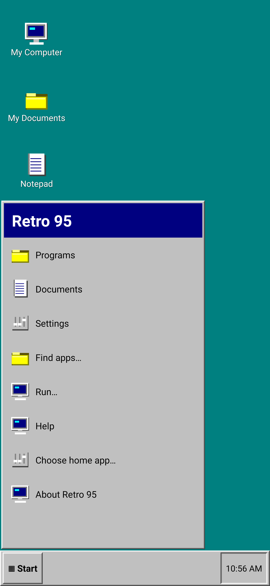
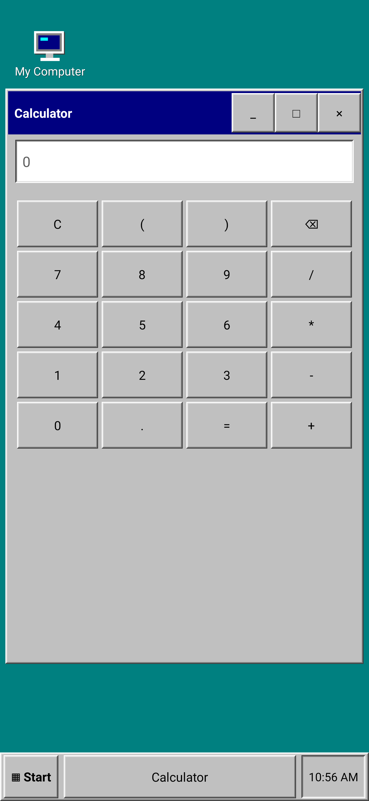

# Retro 95 Launcher

A native Android home launcher with a Windows 95-inspired desktop, Start menu, taskbar, original pixel icons and beveled tool windows. Built for Magesh's Galaxy S24 Ultra; targets Android 16 (API 36), minimum Android 11 (API 30). No native libraries: the APK works on ARM64 phones and x86_64 emulators.

## Features

- Default HOME launcher using Android's Home role chooser.
- Programs explorer with installed-app search; long-press apps to pin/unpin shortcuts or view app information.
- Profile-aware app launching through LauncherApps. Android-permitted work apps are badged; paused profiles fail gracefully. Samsung Secure Folder / Android Private Space are not supported.
- Persistent Notepad with Android share-sheet export, arithmetic Calculator, Run program/web lookup, month calendar and Control Panel.
- Classic teal desktop, five desktop colors, standard/large icons, responsive grid, minimize/restore/maximize/close controls.
- Portrait, landscape, window resizing, IME, display cutout and navigation inset handling. Main controls use 48 dp touch targets; title-bar buttons are 48 × 44 dp.
- No ads, analytics, account, network permission, broad package permission or broad file permission. Notes/settings stay in app-private preferences; the manifest sets `allowBackup=false`.

A launcher themes its own screens. It cannot theme Samsung's notification shade, lock screen, recents, permission dialogs, keyboard or other installed apps. This is an Android launcher, not a Windows emulator. Only one built-in tool window is open at once. Window dragging and Android app widgets are not implemented. Recycle Bin explains shortcut removal; it does not manage deleted files. My Documents uses Android's document picker. Third-party launcher gesture animations remain controlled by Samsung.

## Download

[Download the development APK](apk/Retro95-1.0.0.apk?raw=true)

See [TEST_REPORT.md](TEST_REPORT.md) for executed checks and remaining Samsung device checks.

## Install on Galaxy S24 Ultra / One UI

1. Transfer `Retro95-1.0.0.apk` to the phone and open it. Allow installation from the specific browser or file manager if Android requests it. Samsung Auto Blocker may prevent sideloading; use Settings to review that choice and restore your preferred protection afterwards.
2. Open **Retro 95 → Control Panel → Set Retro 95 as default launcher** and confirm the Android chooser.
3. Tap **My Computer** or **Start → Programs** to launch apps. Hold an app to pin it.
4. Return to Samsung at **Control Panel → Choose another home app → One UI Home**, or **Android Settings → Apps → Choose default apps → Home app**.

The delivered build uses a development signing certificate. Keep a stable private signing key for future releases; never commit private keys. A differently signed future APK requires uninstalling this one, which deletes its local notes/settings.

## Build

JDK 21 for Android 16 Robolectric tests (production sources compile as Java 17), Gradle 8.13, Android SDK platform 36 and build-tools 36.0.0.

```sh
export ANDROID_HOME=/path/to/android-sdk
export JAVA_HOME=/path/to/jdk-21
sdkmanager 'platforms;android-36' 'build-tools;36.0.0' 'platform-tools'
./gradlew testDebugUnitTest lintDebug assembleDebug assembleDebugAndroidTest
```

The SDK-only fallback avoids third-party runtime/build dependencies beyond JDK and Google's installed SDK tools:

```sh
./scripts/build-sdk.sh
./scripts/build-device-tests.sh
adb install -r app/build/sdk/Retro95-1.0.0.apk
adb install -r app/build/sdk-tests/tests.apk
adb shell am instrument -w dev.magesh.win95.test/dev.magesh.win95.LauncherInstrumentation
```

It builds the same production Java/resources, runs javac → D8 → AAPT2 packaging → zipalign → apksigner, and uses the local Android debug key. Gradle remains the usual development/CI route. APK output: `app/build/sdk/Retro95-1.0.0.apk` or `app/build/outputs/apk/debug/app-debug.apk`.

## Tests

See `TEST_REPORT.md` for checks actually executed and remaining device checks. JUnit calculator tests and Robolectric activity tests live under `app/src/test`; AndroidX and SDK-only device suites live under `app/src/androidTest`. GitHub Actions includes build, unit tests, lint and emulator tests; the presence of the workflow does not mean it has already run.

## Source layout

- `DesktopActivity.java`: desktop, app discovery/launching, windows and tools.
- `RetroStyle.java`: beveled controls and original pixel-art icons.
- `Calculator.java`: bounded arithmetic parser using BigDecimal.
- `scripts/`: SDK build and device verification helpers.

Independent project, not affiliated with Microsoft, Samsung or Google. Windows is a Microsoft trademark. No Microsoft artwork, fonts, operating-system files or binaries are bundled.

## Rendered preview

Android 16 Robolectric native renders (not Samsung device screenshots):




